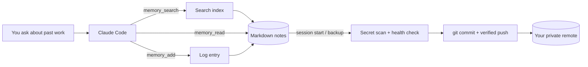

<div align="center">

# Memory Brain

**Persistent, searchable, backed-up memory for Claude Code.**

Claude keeps your whole project history searchable but loads only what each question needs, so it stays informed at a fraction of the token cost. It records what failed or was decided, and shows you at the start of every chat whether the memory is healthy.

[](CHANGELOG.md)
[](LICENSE)
[](https://nodejs.org)
[](#verification)
[](#architecture)

[Quick start](#quick-start) · [Smart context](#smart-context) · [Features](#features) · [Architecture](#architecture) · [Configuration](#configuration) · [Security](#security-and-privacy) · [Documentation](#documentation)

</div>

---

## Overview

Claude Code starts every conversation without knowing what you decided yesterday. Memory Brain gives it a durable project memory that stays on your machine, in plain Markdown files you own.

| Problem | What Memory Brain does |
|---|---|
| Past decisions are forgotten between chats | Claude searches your notes before answering questions about past work |
| Notes go stale or get lost | A health badge reports note count, staleness and backup status in every new chat |
| Loading all notes burns tokens | Smart context: everything stays searchable, but Claude fetches only the part a question needs, when it needs it |
| Memory has no safety net | Every change is committed to git and pushed to a remote you choose, and the push is verified |
| Secrets leak into notes | Writes, commits and pushes that contain key-shaped text are refused |
| The model guesses when nothing is recorded | Claude is instructed to answer "not recorded" instead |

## Smart context

Memory Brain never pastes your notes into the conversation. Claude knows what exists from a cheap index, and pulls detail in tiers, stopping as soon as it has the answer.

| Tier | Tool call | What comes back | Typical cost |
|---|---|---|---|
| 1. Discover | `memory_index` | One line per project, or every open failure and to-do with `open: true` | Smallest |
| 2. Locate | `memory_search` | The best few notes, each with a short snippet. Finds notes by any wording, typos included | Small |
| 3. Understand | `memory_read` | Only the **Now** summary and the **Map** of one note | Small, fixed size |
| 4. Drill down | `memory_read` with `sections` or `entries` | Just the section or Log entries you name | On demand |
| 5. Deep analysis | `memory_read` with `full: true` | The whole note, including the Archive | Rare |

The summary tier stays small because **Now** is capped at 40 lines and generated from the Log, so it does not grow as history piles up.

**Measured on a real memory folder** (50 layered project notes, token counts estimated at 4 characters per token):

| | Tokens |
|---|---|
| All 50 notes in full | about 411,000 |
| Their summary blocks (what a normal lookup reads) | about 54,000 |
| Reduction | about 87% |
| Largest single note: full vs summary | about 129,000 vs about 1,500 |

Nothing is lost to get this saving. The full history stays on disk and is one tool call away. When the notes do not state an answer, Claude says "not recorded" instead of reading more or guessing.

## Features

| Capability | Detail |
|---|---|
| **Health badge** | One line at the start of each new chat: live notes, stale notes, last save, last backup, problems. |
| **Four MCP tools** | `memory_index`, `memory_search`, `memory_read`, `memory_add`. Search is field-weighted BM25 with typo tolerance, aliases and folder-aware ranking. |
| **Smart context** | Tiered, on-demand retrieval: discover, locate, summarise, then drill down only as far as the question needs. About 87% fewer tokens than loading notes in full on a real memory folder. See [Smart context](#smart-context). |
| **Layered notes** | Each project note has a generated **Now** summary, a generated **Map**, an append-only dated **Log**, and an **Archive**. See [NOTE-FORMAT](docs/NOTE-FORMAT.md). |
| **Tamper detection** | If a note is edited by hand after its last Log entry, reads and searches warn that the summary may be stale. |
| **Save reminder** | After a reply that edited three or more files without logging, Claude is reminded once (at most every 30 minutes per chat). |
| **Verified backup** | Secret scan, health check, commit, push, then a check that the remote holds the same commit. Success is reported only if it does. |
| **Secret guard** | Refuses key-shaped text in `memory_add`, in the git pre-commit and pre-push hooks, and before every backup. |
| **Lossless converter** | `/memory-brain:convert` migrates existing prose notes to the layered format, previews each one, proves no original line is lost, and backs up first. |
| **Guided setup with undo** | `/memory-brain:setup` asks one question at a time, changes nothing without a yes, and `setup.js undo` restores your previous settings. |
| **Restore** | Rebuild the memory folder from the backup into an empty directory and verify it matches. |

## Quick start

**Requirements:** Node.js 18 or newer and git. The GitHub CLI (`gh`) is optional.

```text
/plugin marketplace add syed-anas-ahmad-shah/memory-brain
/plugin install memory-brain@memory-brain-market
/memory-brain:setup
```

Setup inspects your machine first, asks what it needs, and makes no change until you confirm. Then restart Claude Code and look for the badge:

```text
Memory OK · saved 12 h ago · backup ok (10-19 08:07) · 114 live notes · 3 stale
```

To make Claude consult memory in every chat, add the short rule from the [Guide](docs/GUIDE.md#3-the-rule-that-makes-claude-use-the-tools) to your `CLAUDE.md`. Setup can add it for you.

## Architecture



| Layer | Implementation |
|---|---|
| Runtime | Plain Node.js scripts. No runtime dependencies, no network calls except the git push you configure. |
| Interface | One MCP server (stdio) exposing four tools, plus two hooks (`SessionStart`, `Stop`) and two skills (`setup`, `convert`). |
| Storage | Markdown files with YAML frontmatter in a folder you choose. No database. |
| Backup | Plain git, with an optional `gh` account for pushes and a configurable commit author. |

Answering a question follows a fixed path: `memory_search` returns the best notes with a short snippet, `memory_read` returns only the **Now** block and **Map** by default, and if the notes do not state the answer, Claude says so instead of guessing.

## Configuration

Options are set in the plugin settings and stored in your Claude settings, never in the notes folder.

| Option | Required | Description |
|---|---|---|
| `brain_dir` | Yes | The memory folder (the one that contains `MEMORY.md`). |
| `backup_remote` | No | Git URL or remote name for backups. Empty means local commits only. |
| `gh_account` | No | Push with this GitHub CLI login. Needed when two GitHub accounts are signed in on one machine. |
| `commit_name`, `commit_email` | No | Author for backup commits, for example a noreply address. |
| `stale_days` | No | Days before a project note counts as stale. Default `30`. |

## Security and privacy

| Area | Behaviour |
|---|---|
| Local-first | Notes are files on your disk. Nothing is sent anywhere except to the git remote you configure. |
| No silent changes | Setup backs up your Claude settings and `CLAUDE.md` first. `node setup.js undo` restores them. Your notes are never touched by undo. |
| Secrets | Refused by `memory_add`, blocked by git hooks, scanned before every backup. An allowlist file handles intentional exceptions. |
| Existing hooks | Git hooks that are not part of this plugin are never overwritten. |
| Data retention | Nothing is deleted. Converted notes keep their original text under `## Archive`. |

To report a vulnerability, see [SECURITY.md](SECURITY.md).

## Verification

| Check | Result |
|---|---|
| Automated tests | 6 suites (main 83, note-convert 27, memory-tools 67, note-log 60, note-format 28, save-reminder 18). Planted-bug copies are used to confirm the tests fail when they should. |
| Platforms | Windows and Linux (Ubuntu 24.04 under WSL, Node 22) pass every suite. A clean-machine install, setup, recall and convert run was completed with real Claude Code. **macOS is plain Node but has not been run.** |
| Retrieval quality | The right note is in the top 3 results for about 92% of 64 test questions (a plain index scores 53%). This measures finding the note, not answer correctness. |
| Answer quality | In a 14-question run with a small model and an automatic grader: 9 fully correct, 4 partly correct, 1 wrong, memory tools used every time. A small sample, not a benchmark. |

Run the tests from the repository root:

```bash
cd plugins/memory-brain/tests
node run.js
node memory-tools.test.js
node note-convert.test.js
node note-log.test.js
node note-format.test.js
node save-reminder.test.js
```

The reminder and the `CLAUDE.md` rule only help if Claude follows them. Check the badge and read what it reports.

## Documentation

| Document | Contents |
|---|---|
| [Guide](docs/GUIDE.md) | Day-to-day use: reading the badge, the four tools, backups, undo and restore, troubleshooting. |
| [Note format](docs/NOTE-FORMAT.md) | The layered note format in detail. |
| [Changelog](CHANGELOG.md) | What changed in each version. |
| [Security policy](SECURITY.md) | How to report a vulnerability. |

## Repository layout

```text
.claude-plugin/        Marketplace manifest
plugins/memory-brain/
  .claude-plugin/      Plugin manifest and user options
  hooks/               SessionStart and Stop hooks
  scripts/             MCP server, backup, setup, converter, guards
  skills/              /memory-brain:setup and /memory-brain:convert
  tests/               Test suites
docs/                  Guide and note format
```

## Disclaimer

Memory Brain is an independent, community-made plugin for Claude Code. It is not made, endorsed or sponsored by Anthropic. "Claude" and "Claude Code" are trademarks of Anthropic, PBC, are used here only to say what this plugin works with, and are not covered by this project's licence.

Released under the [MIT License](LICENSE).
